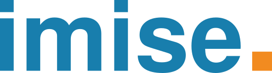
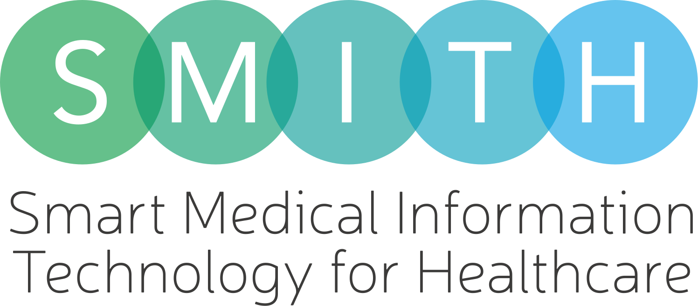
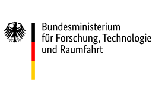

[Deutsche Version unten.](#nachwuchsgruppe-top)

---

# Junior Research Group TOP

## Intelligent Knowledge Models as the Basis of Modern Phenotyping

Phenotyping is essential for the early detection of diseases and the development of targeted therapies. The junior research group *Terminology- and Ontology-based Phenotyping* (TOP) is developing innovative approaches for data-driven phenotyping with advanced methods of semantic modelling and data integration.

*Text: Christoph Beger, Franz Matthies, Ralph Schäfermeier, Dr. Konrad Höffner, Dr. Alexandr Uciteli (Leipzig University)*

Human characteristics such as morphological and physiological characteristics, biochemical indicators and behavioural profiles are referred to as phenotypes. Phenotyping deals with the detailed and systematic recording and evaluation of these characteristics and is central to translational research and personalized medicine. Comprehensive phenotyping makes it possible to decipher complex processes of disease development, to divide heterogeneous patient cohorts into groups and to develop individualized therapeutic approaches in the context of precision medicine.

## PHENOTYPING IN TRANSITION: FROM MANUAL DATA ANALYSIS TO INTELLIGENT ALGORITHMS

Conventional phenotyping is primarily based on the manual analysis of clinical information from structured, unstructured or image-based sources. These processes are time- and resource-intensive, prone to subjective differences and only scalable to a limited extent. With the increasing availability of extensive biomedical data, a previously untapped research potential for automated methods is opening up: In particular, the analysis of electronic patient records enables new forms of patient stratification and the identification of unknown disease correlations. Modern phenotyping strategies that use models or algorithms can ensure the desired automation. However, they are limited by data heterogeneity, semantic inconsistencies and the need for close cooperation between domain experts and IT experts. The underlying models can reach considerable complexity, while decision-making processes are often documented in an unstructured way in texts or diagrams. High implementation effort and low transferability limit the broad application of such algorithms.

To exploit the full potential of phenotyping, powerful tools are therefore needed that enable domain experts to model complex phenotypic knowledge precisely, to link it with terminologies and to apply queries based on it reliably to almost any data source. In this way, what has so far been a resource-intensive practice can become a scalable and reproducible approach for research and precision medicine.

## MODELLING INSTEAD OF PROGRAMMING: NEW PERSPECTIVES FOR PHENOTYPING WITH THE TOP FRAMEWORK

The research focus of the junior research group TOP is model-based phenotyping. Based on an ontological analysis of the concept of phenotype, the group has developed a method for modelling phenotypic knowledge [[1](publications#app12105214), [2](publications#s13326-020-00230-0)]. The resulting models are structured, standardized, explainable and executable. They enable queries across different data sources, whereby medical terminologies are central to the identification of relevant data [[3](publications#shti240855)]. A further focus is semantic search in text documents (e.g. clinical reports). For this purpose, TOP develops methods for document classification and terminology extraction that support ontology- or AI-based search [[4](publications#shti240854), [5](publications#SHTI230710)]. Both phenotyping on structured data and semantic text search are implemented in the TOP Framework [[6](publications#mibe000256)]. Instead of complex and difficult-to-understand programs that have to be developed by IT experts, medical experts can use the TOP Framework to create structured and comprehensible models. These TOP models act as a structured blueprint of knowledge: they describe diseases, phenotypic characteristics or medical terms precisely and define which data are required and how they are semantically linked. Model-based queries return individuals with the defined phenotypes or text documents containing the terms sought.

The TOP Framework is provided as open-source software. This enables university hospitals to install self-managed instances that ensure full control over access rights and compliance with local data protection regulations. Models developed with the TOP Framework can be exchanged across locations and connected to local data sources with the help of suitable adapters.

## THE TOP FRAMEWORK IN ACTION: APPLICATIONS AND OUTLOOK

The Medical Informatics Initiative (MII) pursues the goal of making data from clinical care usable for medical research digitally, reliably and promptly. By means of IT-supported analyses of these data, research contributes to the detection, treatment and prevention of diseases. Within the MII, clinical use cases are intended to close the gap between care and research. INTERPOLAR is one of these use cases and serves the automated detection of medication-related risks and adverse events. In close cooperation with the junior research group TOP, 48 models have already been created with the help of the TOP Framework, which can be applied in the participating data integration centres [[7](publications#shti230695)]. A further contribution the group intends to make is to the MII method platform GeMTeX. Here, the largest German-language, semantically annotated text corpus is being created, which will be made available to the scientific community through elaborate de-identification. To simplify semantic annotation, relevant documents for certain research fields should be pre-selected. In the TOP Framework, this is done by means of so-called search ontologies and concept clusters. Thanks to intuitive modelling of phenotypic knowledge and flexible querying of patient cohorts, the TOP Framework has considerable potential to advance biomedical research. Its generic architecture also allows versatile use within the MII and in other application scenarios.

## ACKNOWLEDGEMENT
Funded by the
<a href="https://www.bmftr.bund.de/" target="_blank">
Federal Ministry of Research, Technology and Space (BMFTR).
</a>

---

# Nachwuchsgruppe TOP

## Intelligente Wissensmodelle als Grundlage der modernen Phänotypisierung

Phänotypisierung ist essentiell für die frühzeitige Erkennung von Krankheiten und die Entwicklung gezielter Therapien. Die Nachwuchsgruppe „Terminologie- und Ontologie-basierte Phänotypisierung“ (TOP) erarbeitet innovative Ansätze für die datengestützte Phänotypisierung mit fortschrittlichen Methoden der semantischen Modellierung und Datenintegration.

*Text: Christoph Beger, Franz Matthies, Ralph Schäfermeier, Dr. Konrad Höffner, Dr. Alexandr Uciteli (Universität Leipzig)*

Menschliche Merkmale wie morphologische und physiologische Charakteristika, biochemische Indikatoren sowie Verhaltensprofile werden als Phänotypen bezeichnet. Die Phänotypisierung beschäftigt sich mit der ausführlichen und systematischen Erfassung und Auswertung dieser Merkmale und ist zentral für die translationale Forschung sowie die personalisierte Medizin. Eine umfassende Phänotypisierung ermöglicht es, komplexe Vorgänge zur Krankheitsentwicklung zu entschlüsseln, heterogene Patientenkohorten in Gruppen einzuteilen sowie individualisierte Therapieansätze im Kontext der Präzisionsmedizin zu entwickeln.

## PHÄNOTYPISIERUNG IM WANDEL: VON MANUELLER DATENAUSWERTUNG ZU INTELLIGENTEN ALGORITHMEN

Die konventionelle Phänotypisierung beruht primär auf manueller Auswertung klinischer Informationen aus strukturierten, unstrukturierten oder bildbasierten Quellen. Diese Prozesse sind zeit- und ressourcenintensiv, anfällig für subjektive Unterschiede und nur eingeschränkt skalierbar. Mit zunehmender Verfügbarkeit umfangreicher biomedizinischer Daten eröffnet sich ein bislang nicht ausgeschöpftes Forschungspotenzial für automatisierte Verfahren: Insbesondere die Auswertung elektronischer Patientenakten ermöglicht neue Formen der Patientenstratifizierung und die Identifikation unbekannter Krankheitskorrelationen. Moderne Phänotypisierungsstrategien, die Modelle bzw. Algorithmen verwenden, können die angestrebte Automatisierung gewährleisten. Sie sind jedoch durch Datenheterogenität, semantische Inkonsistenzen sowie die Notwendigkeit einer engen Zusammenarbeit zwischen Fach- und IT-Expert:innen eingeschränkt. Die zugrundeliegenden Modelle können eine erhebliche Komplexität erreichen, während Entscheidungsprozesse häufig unstrukturiert in Texten oder Schaubildern dokumentiert sind. Hoher Implementierungsaufwand und geringe Übertragbarkeit limitieren die breite Anwendung entsprechender Algorithmen.

Um das volle Potenzial der Phänotypisierung auszuschöpfen, braucht es daher leistungsfähige Werkzeuge, die es Domänenexpert:innen ermöglichen, komplexes phänotypisches Wissen präzise zu modellieren, mit Terminologien zu verknüpfen und darauf basierende Abfragen zuverlässig auf nahezu beliebige Datenquellen anzuwenden. So kann aus der bislang ressourcenintensiven Praxis ein skalierbarer und reproduzierbarer Ansatz für Forschung und Präzisionsmedizin werden.

## MODELLIEREN STATT PROGRAMMIEREN: NEUE PERSPEKTIVEN DER PHÄNOTYPISIERUNG MIT DEM TOP-FRAMEWORK

Der Forschungsschwerpunkt der Nachwuchsgruppe TOP liegt in der modellbasierten Phänotypisierung. Auf Grundlage einer ontologischen Analyse des Phänotypbegriffs hat die Gruppe eine Methode zur Modellierung phänotypischen Wissens entwickelt [[1](publications#app12105214), [2](publications#s13326-020-00230-0)]. Die resultierenden Modelle sind strukturiert, standardisiert, erklärbar und ausführbar. Sie ermöglichen Abfragen über verschiedene Datenquellen, wobei medizinische Terminologien zentral für die Identifikation relevanter Daten sind [[3](publications#shti240855)]. Ein weiterer Schwerpunkt ist die semantische Suche in Textdokumenten (z. B. klinischen Berichten). Dafür entwickelt TOP Verfahren zur Dokumentenklassifikation und Terminologieextraktion, die die Ontologie- bzw. KI-basierte Suche unterstützen [[4](publications#shti240854), [5](publications#SHTI230710)]. Sowohl die Phänotypisierung auf strukturierten Daten als auch die semantische Textsuche sind im TOP-Framework implementiert [[6](publications#mibe000256)]. Anstelle komplexer und schwer verständlicher Programme, die durch IT-Fachleute entwickelt werden müssen, können medizinische Expert:innen mit dem TOP-Framework strukturierte und nachvollziehbare Modelle erstellen. Diese TOP-Modelle fungieren als strukturierter Bauplan des Wissens: Sie beschreiben Krankheiten, phänotypische Merkmale oder medizinische Begriffe präzise und definieren dabei, welche Daten benötigt und wie diese semantisch verknüpft werden. Modellbasierte Abfragen liefern Individuen mit den definierten Phänotypen oder Textdokumente mit den gesuchten Begriffen.

Das Framework wird als Open-Source-Software bereitgestellt. Dies ermöglicht Universitätsklinika die Installation von selbstverwalteten Instanzen, die vollständige Kontrolle über Zugriffsrechte sowie die Einhaltung lokaler Datenschutzbestimmungen gewährleisten. Mit dem TOP-Framework entwickelte Modelle lassen sich standortübergreifend austauschen und mit Hilfe geeigneter Adapter an lokale Datenquellen anbinden.

## TOP-FRAMEWORK IN AKTION: ANWENDUNGEN UND AUSBLICK

Die Medizininformatik-Initiative (MII) verfolgt das Ziel, Daten aus der klinischen Versorgung digital, zuverlässig und zeitnah für die medizinische Forschung nutzbar zu machen. Mittels IT-gestützter Analysen dieser Daten trägt die Forschung zur Erkennung, Behandlung und Prävention von Krankheiten bei. Innerhalb der MII sollen klinische Anwendungsfälle die Lücke zwischen Versorgung und Forschung schließen. INTERPOLAR ist einer dieser Anwendungsfälle und dient der automatisierten Erkennung medikationsbedingter Risiken und unerwünschter Ereignisse. In enger Kooperation mit der Nachwuchsgruppe TOP entstanden dabei mit Hilfe des TOP-Frameworks bereits 48 Modelle, die in den beteiligten Datenintegrationszentren angewendet werden können [[7](publications#shti230695)]. Einen weiteren Beitrag will die Gruppe für die MII-Methodenplattform GeMTeX leisten. Hier wird das größte deutschsprachige, semantisch annotierte Textkorpus erstellt, das durch aufwendige De-Identifikation der wissenschaftlichen Community zur Verfügung stehen wird. Zur Vereinfachung der semantischen Annotation sollten relevante Dokumente für bestimmte Forschungsfelder vorausgewählt werden. Im TOP-Framework erfolgt dies mittels sogenannter Search-Ontologien und Concept-Cluster. Dank intuitiver Modellierung phänotypischen Wissens sowie flexibler Abfrage von Patientenkohorten besitzt das TOP-Framework ein erhebliches Potenzial zur Förderung der biomedizinischen Forschung. Seine generische Architektur erlaubt zudem eine vielseitige Nutzung innerhalb der MII und in anderen Anwendungsszenarien.

## ACKNOWLEDGEMENT
Gefördert durch das
<a href="https://www.bmftr.bund.de/" target="_blank">
Bundesministerium für Forschung, Technologie und Raumfahrt (BMFTR).
</a>

Text zuerst erschienen im One MII Journal 2026/text originally published in the One MII Journal 2026.

  
  
  
  
  

